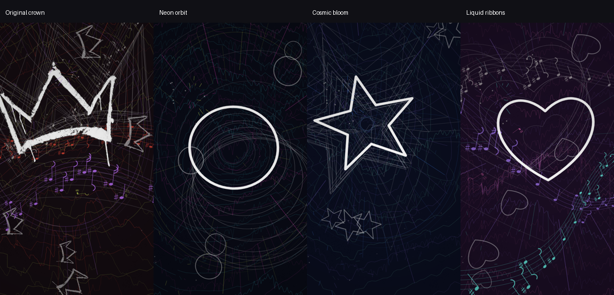

# SoundWaive

A lightweight, offline Android app for making sound-reactive music videos. Built with Kotlin and Rust for Android 8.0 and newer on 32-bit and 64-bit ARM and Intel devices. Originally delivered as CrownPulse, now developed here as SoundWaive.

Import a FLAC, choose a look, customize it, and export an MP4 with your music. The original preset includes the distressed three-point crown, a constant symbol color, flying musical staves, reactive particles and filaments. Text is off by default.

## What you can change

- Eight presets, nine built-in symbols, custom artwork, symbol/color locks and saved looks.
- Photo, GIF or video backgrounds behind every effect, synced to the music.
- Render quality: Fast (360p, upscaled), Balanced (720p) or Full.
- Palettes, background colors, grain, glow, vignette and optional titles.
- Beat effects locked to the song's beats and bars: rings on every beat, a punch-in on the first beat of each bar and a red/cyan color split on snares.
- Particle density, echoes, trails, rings, spectrum layers, glitch, drift, rotation, zoom and shake.
- Flying staves, estimated bass notes, beat sensitivity, frequency gains and timing offset.
- Randomized variations with a repeatable seed and bar-based scene changes.
- Portrait, square, landscape and 4:5 export; 720p/1080p; 24/30/60 fps; quality, trimming and fades.

No account, network permission, cloud upload or model download. Songs, caches and exported videos use additional device storage.

[User guide](docs/QUICK-START.md) · [Build instructions](docs/BUILDING.md) · [Architecture](docs/ARCHITECTURE.md) · [Verification](docs/VERIFICATION.md)

## Build from a fresh checkout

Install JDK 17, the Android SDK command-line tools, Rust via rustup, Python 3 and FFmpeg. Then:

```sh
sdkmanager 'platforms;android-35' 'build-tools;36.0.0' 'ndk;28.2.13676358'
# Set ANDROID_HOME to your SDK directory, or sdk.dir in local.properties.
./gradlew check :app:assembleDebug
```

The checked-in Rust toolchain file installs the pinned compiler, formatter and four Android targets when Cargo first runs. The Gradle wrapper downloads its checksum-verified distribution. The build generates its small demo from oscillators/noise, then compiles the Rust library for `arm64-v8a`, `armeabi-v7a`, `x86` and `x86_64`. Gradle packages the offline sharpening runtime for each architecture.

Install `app/build/outputs/apk/debug/app-debug.apk`. Development builds use a separate Android identity so they can coexist with the signed private app. See [release signing](docs/BUILDING.md#release-signing) for update-compatible release builds.

## GitHub builds

Every push to `main`, pull request, or manual **Android build** run performs Rust tests, MP4 timing tests, asset integrity checks, Android lint, and builds APK/AAB packages. Open [Actions](https://github.com/thekidd0329/SoundWaive/actions/workflows/android.yml), select a successful run, and download its `SoundWaive-<commit>` artifact.

`SoundWaive-dev.apk` installs directly. The release APK and AAB in CI are explicitly **unsigned**; sign them with the owner's private key before distribution. Signing keys and passwords are never stored in this repository.

## Design and limits

Kotlin owns the Android interface, playback and hardware-codec export. Rust analyzes frequency energy, transients, tempo, beats and bars, and approximate bass pitches. Preview and export share one deterministic renderer. Export uses the device’s compatible H.264 and AAC-LC encoders. If a video preset exceeds the encoder’s limits, the result shows the size, frame rate and bitrate used.

Keep the app open during analysis. Exports keep running in the background, with a notification that shows the percentage. Supported input is mono/stereo music up to 30 minutes, subject to the phone's codecs. The bass notes are expressive animation, not verified sheet-music transcription. Builds 1.0 through 1.11 were tested on device in real time; later builds and the full record are in the [verification notes](docs/VERIFICATION.md).



The screenshots show the original CrownPulse build; SoundWaive retains its visual design. The Android application ID remains `com.parker.crownpulse` for compatibility with that installation. The included demo is generated from oscillators and noise, with no unreleased recordings. The crown artwork belongs to the owner; see [media and code rights](LICENSE.md).
